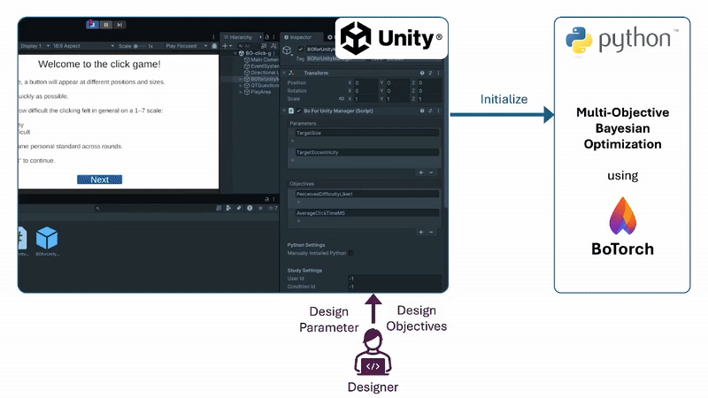

# Interactive Bayesian Optimization (IBO)

[](https://doi.org/10.5281/zenodo.19786494)

**[Pascal Jansen](https://pascal-jansen.github.io)**, Ulm University · **[Mark Colley](https://m-colley.github.io)**, University College London



Interactive Bayesian Optimization (IBO) runs **human-in-the-loop Bayesian optimization** in interactive systems: you declare
**design parameters** (what the system may change) and **objectives** (what a person's ratings or behavior score), and a
Bayesian optimizer proposes the next design to show after every evaluation. Good designs, or the **Pareto front** of best
trade-offs, are found with far fewer trials than manual tuning, A/B tests or grid search.

One Python optimizer serves every integration over the same [protocol](protocol/README.md): **Unity**, **Unreal Engine**
and **Python**, and any other engine or experiment tool that can open a local TCP connection. IBO continues
*Bayesian Optimization for Unity*; see the [migration guide](docs/migration-to-ibo.md) if you used it.

## Features

- Single- and multi-objective Bayesian optimization on [BoTorch](https://botorch.org), with an optional
  [botorch-rust](https://github.com/M-Colley/botorch-rust) model library.
- Cost-aware optimization ([CABOP](https://dl.acm.org/doi/full/10.1145/3772318.3791024)) when design changes have different costs.
- Dynamic BO ([DBO](https://doi.org/10.1109/LRA.2026.3665072)) for objectives that drift during a session (learning, fatigue).
- Contextual optimization with a latent context embedding multi-task GP (LCE-M) to reuse data across users, devices or environments.
- Transfer from prior participants (MetaTAF).
- Explicit feedback (questionnaires; QuestionnaireToolkit add-on for Unity) and implicit feedback (telemetry, behavior).
- CSV logging per participant and condition, warm starts, reproducible seeds, concurrent studies on separate ports.

## Integrations

| Integration | Where | Start here |
|---|---|---|
| Unity | `Unity/` (Unity project; package in `Unity/Assets/IBO`) | [Unity guide](Unity/README.md), [Unity manual](docs/unity-manual.md) |
| Unreal Engine | `Unreal/` (C++ plugin with a Blueprint component) | [Unreal guide](Unreal/README.md) |
| Python | `Python/` (`pip install ./Python`, package `interactive_bo`) | [Python guide](Python/README.md) |
| Anything else | your client of the IBO protocol | [Protocol](protocol/README.md) |

Every integration needs **Python 3.13** with the pinned packages of [`Backend/requirements.txt`](Backend/requirements.txt)
(Unity installs them into a private environment on the first Play).

**Unity**: open `Unity/` in Unity 6000.6 (tested; the package also compiles and passes its EditMode tests on 6000.4), choose
**Tools > IBO > Create Analytic Demo** and press Play. The questionnaire examples (`BO-example-scene`, the Fitts's law
study and others) are in `Assets/IBO-QuestionnaireToolkit/Samples/Scenes`.

**Unreal**: copy `Unreal/Plugins/BayesianOptimization` into a C++ project and follow the [Unreal guide](Unreal/README.md).

**Python**: run a complete study with a simulated participant:

```bash
python -m pip install ./Python
```

```bash
python -m interactive_bo demo --python /path/to/python-with-the-requirements
```

## Repository layout

| Folder | Content |
|---|---|
| `Backend/` | The optimizer: backends, IBO server (`ibo_server.py`), requirements, licenses, example data |
| `Unity/`, `Unreal/`, `Python/` | Integrations; `Unity/` and `Unreal/` carry generated copies of `Backend/` |
| `protocol/` | IBO protocol specification and JSON schema |
| `tools/` | `sync_backends.py` (engine copies of `Backend/`) and release packaging |
| `tests/` | Python tests of the backend |
| `docs/` | Manual, migration guide, architecture, validation, backend guides, [roadmap](docs/ibo/ROADMAP.md) |

Change the optimizer only in `Backend/`, then regenerate and verify the engine copies:

```bash
python tools/sync_backends.py
```

```bash
python tools/sync_backends.py --check
```

```bash
python -m pytest -q tests
```

```bash
python -m unittest discover Python/tests
```

## Documentation

- [Unity manual](docs/unity-manual.md): concepts, every setting, logging, troubleshooting
- [Migration guide](docs/migration-to-ibo.md) from Bayesian Optimization for Unity 1.x
- [IBO protocol](protocol/README.md) for new integrations
- [Architecture](docs/architecture.md), [validation record](docs/validation.md), [render pipelines](docs/render-pipeline-support.md)
- Backend guides: [Dynamic BO](docs/dbo-backend.md), [MetaTAF](docs/meta-taf-student-guide.md)
- [Roadmap](docs/ibo/ROADMAP.md)

## Publications

Scientific publications built on IBO (as Bayesian Optimization for Unity):

**2026**

[BlurDriving: Investigating How Personalized Blur Techniques Impact Drivers' Performance in Virtual Reality](https://dl.acm.org/doi/10.1145/3831646). In *Proceedings of the ACM on Interactive, Mobile, Wearable and Ubiquitous Technologies*, Vol. 10. **IMWUT**. ACM.

[Comparing Preferences Between Japan and Germany for External Communication of Automated Vehicles Using Bayesian Optimization](https://dl.acm.org/doi/10.1145/3831988). In *Proceedings of the ACM on Interactive, Mobile, Wearable and Ubiquitous Technologies*, Vol. 10. **IMWUT**. ACM.

[Multi-Session User Experience Assessments of Computationally Optimized Automated Vehicle Functionality Visualizations](https://dl.acm.org/doi/10.1145/3828157.3828785). In *Proceedings of the 18th International Conference on Automotive User Interfaces and Interactive Vehicular Applications*. **AutomotiveUI '26**. ACM.

[MoTUI: Personalization of In-Vehicle Tactile Interfaces for People With Vision Impairments and the Blind](https://pascal-jansen.github.io/data/publications/MoTUI.pdf). In *Proceedings of the 39th Annual ACM Symposium on User Interface Software and Technology*. **UIST '26**. ACM.

[ProVoice: Designing proactive functionality for in-vehicle conversational assistants using multi-objective Bayesian optimization to enhance driver experience](https://dl.acm.org/doi/full/10.1145/3772318.3791877). In *Proceedings of the 2026 CHI Conference on Human Factors in Computing Systems*. **CHI '26**. ACM.

**2025**

[OptiCarVis: Improving automated vehicle functionality visualizations using Bayesian optimization to enhance user experience](https://dl.acm.org/doi/full/10.1145/3706598.3713514). In *Proceedings of the 2025 CHI Conference on Human Factors in Computing Systems*. **CHI '25**. ACM.
  **Best Paper Honorable Mention (top 5%)**

[Improving external communication of automated vehicles using Bayesian optimization](https://dl.acm.org/doi/full/10.1145/3706598.3714187). In *Proceedings of the 2025 CHI Conference on Human Factors in Computing Systems*. **CHI '25**. ACM.

[Fly Away: Evaluating the impact of motion fidelity on optimized user interface design via Bayesian optimization in automated urban air mobility simulations](https://dl.acm.org/doi/full/10.1145/3706598.3713288). In *Proceedings of the 2025 CHI Conference on Human Factors in Computing Systems*. **CHI '25**. ACM.

## Citation

If you use IBO in research, please cite it:

```bibtex
@software{jansen_interactive_bayesian_optimization,
  author    = {Pascal Jansen and Mark Colley},
  title     = {Interactive Bayesian Optimization (IBO), formerly Bayesian Optimization for Unity},
  publisher = {Zenodo},
  doi       = {10.5281/zenodo.19786494},
  url       = {https://doi.org/10.5281/zenodo.19786494}
}
```

## License

MIT, see [LICENSE](LICENSE). Vendored components keep their licenses; see [THIRD-PARTY-NOTICES.txt](THIRD-PARTY-NOTICES.txt).
The multi-engine layout and the Unreal integration come from
[Bayesian-Optimization-for-Game-Engines](https://github.com/M-Colley/Bayesian-Optimization-for-Game-Engines).
Parts of the code were written with AI coding assistants (OpenAI Codex, Anthropic Claude).
