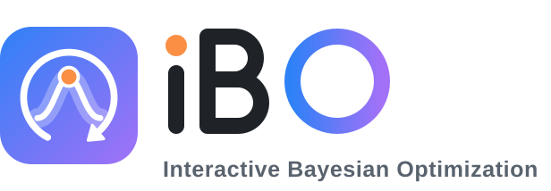
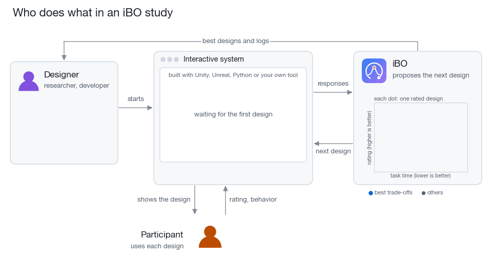
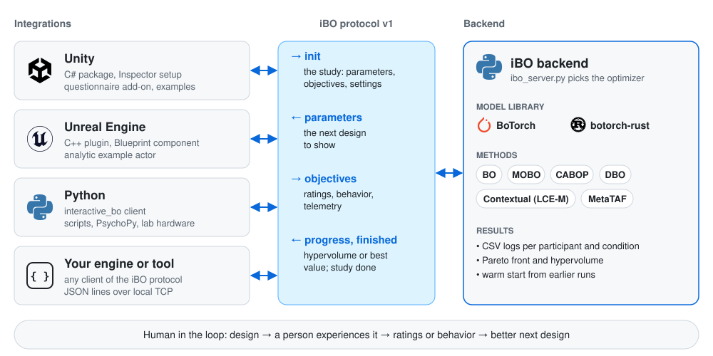
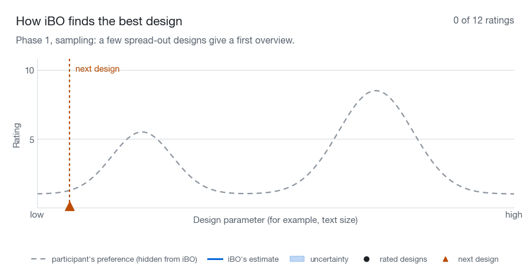
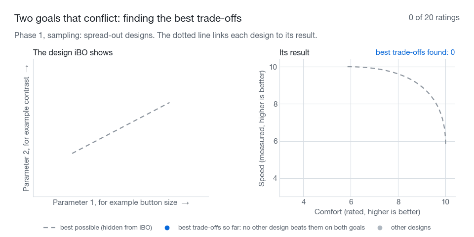
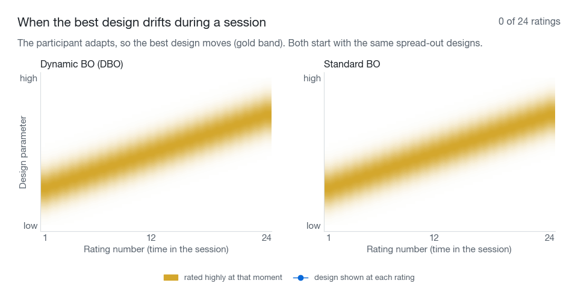

<h1 align="center">
  <picture>
    <source media="(prefers-color-scheme: dark)" srcset="images/ibo-logo-dark.svg">
    
  </picture>
</h1>

<p align="center">
  <b>Human-in-the-loop Bayesian optimization for any interactive system.</b><br>
  Ready for Unity, Unreal Engine and Python; anything else connects through an open protocol.
</p>

<p align="center">
  <a href="Unity/README.md"></a>
  <a href="Unreal/README.md"></a>
  <a href="Python/README.md"></a>
  <a href="protocol/README.md"></a>
  <a href="https://botorch.org"></a>
  <a href="LICENSE"></a>
  <a href="https://doi.org/10.5281/zenodo.16849778"></a>
  <a href="https://github.com/Pascal-Jansen/Interactive-Bayesian-Optimization/actions/workflows/python-checks.yml"></a>
</p>

<p align="center">
  <b><a href="https://pascal-jansen.github.io">Pascal Jansen</a></b><sup>1</sup>&nbsp;&nbsp;·&nbsp;&nbsp;<b><a href="https://m-colley.github.io">Mark Colley</a></b><sup>2</sup><br>
  <sup>1</sup>Ulm University&nbsp;&nbsp;·&nbsp;&nbsp;<sup>2</sup>University College London
</p>

<picture>
  <source media="(prefers-color-scheme: dark)" srcset="images/ibo-roles-dark.gif">
  
</picture>

<picture>
  <source media="(prefers-color-scheme: dark)" srcset="images/ibo-overview-dark.svg">
  
</picture>

## What iBO does

You declare **design parameters** (what the system may change, such as sizes, colors or timings) and **objectives**
(what a person's ratings or behavior score, such as usability or task time). iBO's Bayesian optimizer then proposes the
next design to show after every evaluation. It finds good designs, or the **Pareto front** of best trade-offs between
several objectives, with far fewer trials than manual tuning, A/B tests or grid search.

iBO is not tied to an engine: the optimizer runs as its own process, and whatever shows the designs talks to it over
a small open protocol. iBO continues *Bayesian Optimization for Unity*: its last version, 1.9.1, stays
available in the [`BOforUnity`](https://github.com/Pascal-Jansen/Interactive-Bayesian-Optimization/tree/BOforUnity)
branch, and the [migration guide](docs/migration-to-ibo.md) explains the move to iBO.

## How iBO works

Every study runs the loop shown at the top: iBO proposes a design, the participant uses it, and their rating and
behavior go back to iBO, which updates its estimate of what works. The first few designs are spread out to get an
overview (**sampling**); after that, iBO picks designs where its estimate is high or still uncertain
(**optimization**). All animations in this README are recorded iBO runs with simulated participants.

### One parameter, one rating

One design parameter, for example text size, and one rating. The dashed curve is what the participant would rate,
which iBO never sees; the blue line is iBO's estimate and the band its uncertainty. After three spread-out designs,
iBO found the peak with its 6th rating, then checked two regions it was still unsure about and spent the last four
ratings on the peak.

<picture>
  <source media="(prefers-color-scheme: dark)" srcset="images/ibo-one-parameter-dark.gif">
  
</picture>

### Two goals that conflict

Comfort and speed pull in different directions, so there is no single best design but a set of best trade-offs, the
Pareto front: designs that no other design beats on both goals. The dotted line links each design iBO shows (left) to
its result (right). With multi-objective BO, 12 of the 20 designs are best trade-offs, all close to the best possible
ones; which compromise to use is then your decision.

<picture>
  <source media="(prefers-color-scheme: dark)" srcset="images/ibo-trade-offs-dark.gif">
  
</picture>

### Preferences that change during a session

People adapt, learn and tire, so the best design moves during a session (the gold band). Both optimizers start with
the same spread-out designs. Dynamic BO (DBO) trusts recent ratings more and follows the moving best design: 15 of its
20 model-guided designs land in the gold band (within 0.1 of the best design at that moment), against 7 for standard
BO, which weighs old and new ratings alike.

<picture>
  <source media="(prefers-color-scheme: dark)" srcset="images/ibo-drift-dark.gif">
  
</picture>

## One optimizer, any front end

Unity, Unreal Engine and Python come with ready-made integrations. Anything else that can open a local TCP connection
and write JSON can run a study too: a VR or driving simulator, an experiment program, a web service, a robot or
haptics controller. Every front end gets the same methods and the same CSV logs.

| Front end | What you use | Start here |
|---|---|---|
| **Unity** | C# package: copy `Assets/iBO` and `Assets/StreamingAssets/BOData` into your project and set it up in the Inspector; samples; optional QuestionnaireToolkit add-on with questionnaire studies and a Fitts's law study | [Unity guide](Unity/README.md), [manual](docs/unity-manual.md) |
| **Unreal Engine** | C++ plugin with a Blueprint component and an analytic example actor; the rest of `Unreal/` (launcher, backend copy) stays in a writable folder | [Unreal guide](Unreal/README.md) |
| **Python programs**: scripts, PsychoPy, lab hardware | `interactive_bo`: client and server launcher | [Python guide](Python/README.md) |
| **Your own tool**: Godot, C++, Java, Node.js, MATLAB, R, ... | Start the server (`ibo serve`) and speak the iBO protocol in any language with TCP sockets and JSON; a JSON schema is included | [Protocol](protocol/README.md) |

This is a complete study on the wire, recorded from iBO (`→` to iBO, `←` from iBO; each message is one line, the
first is wrapped here, numbers are shortened):

```text
→ {"type": "init", "parameters": [{"key": "size", "init": {"low": 0.2, "high": 2.0}}],
   "objectives": [{"key": "usability", "init": {"low": 0, "high": 100, "minimize": 0}}],
   "config": {"nParameters": 1, "nObjectives": 1, "numSamplingIterations": 2, "numOptimizationIterations": 1}}
← {"type": "parameters", "values": {"size": 0.32}, "iteration": 1}
→ {"type": "objectives", "values": {"usability": 75.9}}
← {"type": "tempCoverage", "value": 0.5}
← {"type": "parameters", "values": {"size": 1.26}, "iteration": 2}
→ {"type": "objectives", "values": {"usability": 99.0}}
← {"type": "tempCoverage", "value": 1.0}
← {"type": "coverage", "value": 0.98}
← {"type": "parameters", "values": {"size": 1.60}, "iteration": 3}
→ {"type": "objectives", "values": {"usability": 90.0}}
← {"type": "coverage", "value": 0.98}
← {"type": "optimization_finished"}
```

`tempCoverage` (share of the sampling phase done) and `coverage` (best value so far, on iBO's internal −1 to 1 scale)
report progress and can be ignored. The optimizer behind every front end is in `Backend/`
([Backend](Backend/README.md), [architecture](docs/architecture.md)).

Every iBO [release](https://github.com/Pascal-Jansen/Interactive-Bayesian-Optimization/releases) carries
`iBO-Unity-<version>.zip` and `iBO-Unreal-<version>.zip`. The QuestionnaireToolkit add-on and the Python package come
from this repository (the package is not on PyPI).

## Features

- Single- and multi-objective Bayesian optimization on [BoTorch](https://botorch.org), or on
  [botorch-rust](https://github.com/M-Colley/botorch-rust), a faster Rust implementation installed with the requirements.
- Methods for special studies: cost-aware ([CABOP](https://dl.acm.org/doi/full/10.1145/3772318.3791024)), drifting
  preferences ([DBO](https://doi.org/10.1109/LRA.2026.3665072)), transfer from earlier participants (MetaTAF) and
  several users, devices or environments (contextual LCE-M); see [Choosing an optimizer](#choosing-an-optimizer).
- Explicit feedback (questionnaires; QuestionnaireToolkit add-on for Unity) and implicit feedback (telemetry, behavior).
- CSV logging per participant and condition, warm starts, reproducible seeds, concurrent studies on separate ports.

## Status

Version 2.0.0. There was no iBO 1.x: the numbering continues that of Bayesian Optimization for Unity (1.0 to
1.9.1).

- Windows: [Bayesian-Optimization-for-Game-Engines](https://github.com/M-Colley/Bayesian-Optimization-for-Game-Engines),
  where iBO's layout and Unreal plugin come from, was validated before the renaming with Unity 6000.6 and Unreal
  Engine 5.8.
- macOS: the backend and Python client tests pass, real BO, MOBO and DBO studies ran through the Python
  client, and the Unity package compiles and passes its EditMode tests in Unity 6000.4; no Play-mode run with Python yet.
- Linux: the backend and Python client tests run in CI.
- Not yet validated: the renamed package in Unity 6000.6 and Unreal Engine 5.8, the engine integrations on macOS and
  Linux, and standalone player builds ([validation record](docs/validation.md)).

## Quick start

Run the commands from the repository root. The optimizer needs **Python 3.13** with the pinned packages of
[`Backend/requirements.txt`](Backend/requirements.txt) (several GB with PyTorch).

**Unity**: install Python 3.13; Unity installs the packages into a private environment on the first Play. Open
`Unity/` in Unity 6000.6 (the project's version; the iBO package has so far been tested in 6000.4), open
`Assets/iBO/Samples/Analytic/BO-analytic-demo.unity` and press Play. The questionnaire examples (`BO-example-scene`,
the Fitts's law study and others) are in `Assets/iBO-QuestionnaireToolkit/Samples/Scenes`.

For **Unreal**, **Python** and **your own tool**, create an environment once (on Windows: `py -3.13 -m venv .venv`,
then `.venv\Scripts\...` instead of `.venv/bin/...`):

```bash
python3.13 -m venv .venv
```

```bash
.venv/bin/python -m pip install -r Backend/requirements.txt ./Python
```

**Python**: run a complete study with a simulated participant:

```bash
.venv/bin/ibo demo
```

**Unreal**: copy `Unreal/Plugins/BayesianOptimization` into the `Plugins` folder of a C++ project and build it, start
the backend with `.venv/bin/python Unreal/launch_backend.py --backend botorch --objectives 1`, add a
`BoAnalyticDemoActor` to a level and press Play ([Unreal guide](Unreal/README.md)).

**Your own tool**: start a server with `.venv/bin/ibo serve`, connect to `127.0.0.1:56001` and exchange the messages
shown [above](#one-optimizer-any-front-end) ([protocol](protocol/README.md)).

## Choosing an optimizer

| Your study | Backend (`optimizerBackend`) | Details |
|---|---|---|
| One objective, or the Pareto front of several (default) | BoTorch (`botorch`): BO for one objective, MOBO for several | [Manual 8.7](docs/unity-manual.md#87-optimizer-backend-and-cabop-settings) |
| Changing a design costs differently depending on what changes (e.g. swapping hardware) | CABOP (`cabop`) | [Manual 8.7](docs/unity-manual.md#87-optimizer-backend-and-cabop-settings) |
| One objective that drifts during a session (learning, fatigue) | DBO (`dbo`) | [Manual 8.15](docs/unity-manual.md#815-dynamic-bo-dbo-optimizing-a-drifting-objective), [DBO guide](docs/dbo-backend.md) |
| Several objectives, with data of earlier participants to start from | MetaTAF (`meta-taf`; needs the `open-bo` package, see the guide) | [Manual 8.14](docs/unity-manual.md#814-meta-bo-metataf-transfer-from-prior-participants), [MetaTAF guide](docs/meta-taf-student-guide.md) |
| Users, devices or environments that differ but share structure | Contextual optimization (LCE-M): `botorch` with a `context` in the init message (Unity: **Enable Contextual Optimization** in the Inspector) | [Manual 8.13](docs/unity-manual.md#813-contextual-optimization-and-context-embeddings-lce-m-gp) |

## Data and logs

Every run writes semicolon-separated CSV files (observations, Pareto flags or best value, hypervolume, timings) to
`<log root>/<user ID>/<condition ID>/run/`
([manual 8.12](docs/unity-manual.md#812-output-files-and-metrics)). Everything stays on the local machine; use
pseudonymous participant IDs.

| Integration | Log root |
|---|---|
| Unity | `Assets/StreamingAssets/BOData/LogData` (below `persistentDataPath` when StreamingAssets is read-only) |
| Unreal Engine | `--log-root` of `launch_backend.py` (default `~/BayesianOptimizationRuns`) |
| Python | `log_root` or `--log-root` (default `./LogData`) |

## Repository layout

| Folder | Content |
|---|---|
| `Backend/` | The optimizer: backends, iBO server (`ibo_server.py`), requirements, licenses, example data |
| `Unity/`, `Unreal/`, `Python/` | Integrations; `Unity/` and `Unreal/` carry generated copies of `Backend/` |
| `protocol/` | iBO protocol specification and JSON schema |
| `tools/` | `sync_backends.py` (engine copies of `Backend/`), release packaging, and `readme_figures/` (the README figures, drawn from recorded iBO runs) |
| `tests/` | Python tests of the backend and the release tools |
| `docs/` | Manual, migration guide, architecture, validation, backend guides, [roadmap](docs/ibo/ROADMAP.md) |
| `images/` | Figures of the README and the manual |
| `.github/workflows/` | CI checks and the release workflow |

## Contributing

Report bugs and ideas in the [issues](https://github.com/Pascal-Jansen/Interactive-Bayesian-Optimization/issues); pull
requests are welcome. Change the optimizer only in `Backend/`, then regenerate and verify the engine copies and run the
tests, as CI does. They need Python 3.13 with numpy, pandas, pytest and jsonschema. Tests that run real optimizers
need the full stack of `Backend/requirements.txt`: the backend tests use it when it is installed, the Python client's
when `IBO_TEST_PYTHON` names that interpreter, and the Unreal launcher's when `BO_RUN_INTEGRATION_TESTS=1` is set.

```bash
python tools/sync_backends.py
```

```bash
python tools/sync_backends.py --check
```

```bash
python -m pytest -q tests
```

```bash
python -m pytest -q docs/standalone-bridge
```

```bash
python -m unittest discover -s Unreal/tests
```

```bash
python -m unittest discover Python/tests
```

## Documentation

- [Unity guide](Unity/README.md) and [Unity manual](docs/unity-manual.md): concepts, every setting, logging, troubleshooting
- [Unreal guide](Unreal/README.md), [Python guide](Python/README.md)
- [Migration guide](docs/migration-to-ibo.md) from Bayesian Optimization for Unity 1.x
- [iBO protocol](protocol/README.md) for new integrations
- [Architecture](docs/architecture.md), [validation record](docs/validation.md), [render pipelines](Unity/Assets/iBO/Documentation/render-pipeline-support.md)
- Backend guides: [Dynamic BO](docs/dbo-backend.md), [MetaTAF](docs/meta-taf-student-guide.md)
- [Roadmap](docs/ibo/ROADMAP.md), [changelog](CHANGELOG.md)

## Publications

**8 papers** at CHI, UIST, IMWUT and AutomotiveUI used iBO (as Bayesian Optimization for Unity) to optimize interfaces
with people in the loop.

| Year | Venue | Paper |
|---|---|---|
| 2026 | **IMWUT** | [**BlurDriving**: Investigating How Personalized Blur Techniques Impact Drivers' Performance in Virtual Reality](https://dl.acm.org/doi/10.1145/3831646) |
| | **IMWUT** | [Comparing Preferences Between Japan and Germany for External Communication of Automated Vehicles Using Bayesian Optimization](https://dl.acm.org/doi/10.1145/3831988) |
| | **AutomotiveUI '26** | [Multi-Session User Experience Assessments of Computationally Optimized Automated Vehicle Functionality Visualizations](https://dl.acm.org/doi/10.1145/3828157.3828785) |
| | **UIST '26** | [**MoTUI**: Personalization of In-Vehicle Tactile Interfaces for People With Vision Impairments and the Blind](https://pascal-jansen.github.io/data/publications/MoTUI.pdf) |
| | **CHI '26** | [**ProVoice**: Designing proactive functionality for in-vehicle conversational assistants using multi-objective Bayesian optimization to enhance driver experience](https://dl.acm.org/doi/full/10.1145/3772318.3791877) |
| 2025 | **CHI '25** | [**OptiCarVis**: Improving automated vehicle functionality visualizations using Bayesian optimization to enhance user experience](https://dl.acm.org/doi/full/10.1145/3706598.3713514)<br>🏆 Best Paper Honorable Mention (top 5%) |
| | **CHI '25** | [Improving external communication of automated vehicles using Bayesian optimization](https://dl.acm.org/doi/full/10.1145/3706598.3714187) |
| | **CHI '25** | [**Fly Away**: Evaluating the impact of motion fidelity on optimized user interface design via Bayesian optimization in automated urban air mobility simulations](https://dl.acm.org/doi/full/10.1145/3706598.3713288) |

IMWUT: *Proceedings of the ACM on Interactive, Mobile, Wearable and Ubiquitous Technologies*, Vol. 10; all papers are
published by ACM. Used iBO in your research? Open an issue or a pull request to add your paper.

## Citation

If you use iBO in research, please cite it:

```bibtex
@software{jansen_interactive_bayesian_optimization,
  author    = {Pascal Jansen and Mark Colley},
  title     = {Interactive Bayesian Optimization (iBO), formerly Bayesian Optimization for Unity},
  publisher = {Zenodo},
  year      = {2026},
  doi       = {10.5281/zenodo.16849778},
  url       = {https://doi.org/10.5281/zenodo.16849778}
}
```

## License

MIT, see [LICENSE](LICENSE). Vendored components keep their licenses; see [THIRD-PARTY-NOTICES.txt](THIRD-PARTY-NOTICES.txt).
The QuestionnaireToolkit add-on has open license items (see its
[Third-Party Notices](Unity/Assets/iBO-QuestionnaireToolkit/Third-Party%20Notices.txt)) and is not part of the release
packages. The multi-engine layout and the Unreal integration come from
[Bayesian-Optimization-for-Game-Engines](https://github.com/M-Colley/Bayesian-Optimization-for-Game-Engines).
Parts of the code were written with AI coding assistants (OpenAI Codex, Anthropic Claude).
Unity, Unreal Engine, Python and PyTorch are trademarks of their respective owners; their logos only show
which tools iBO works with.
